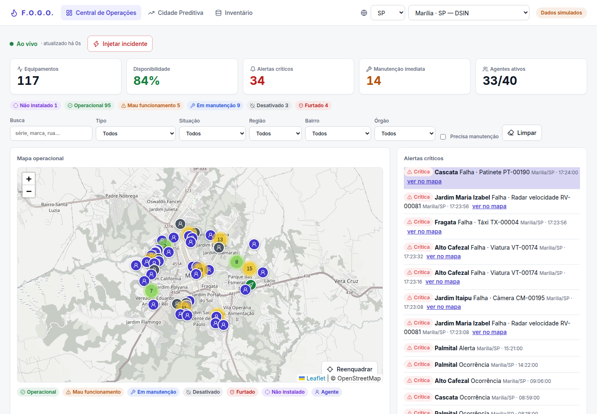
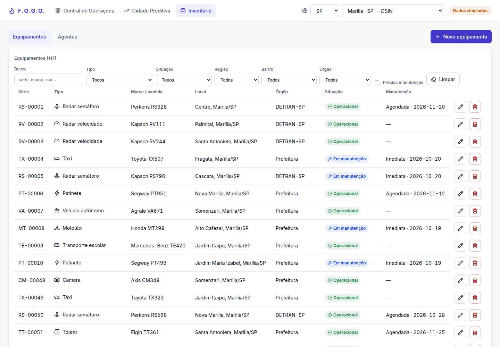
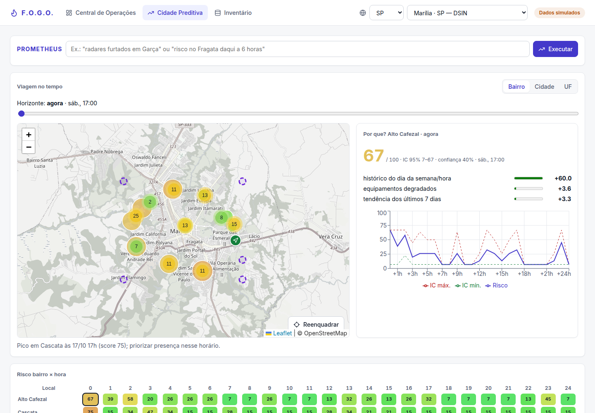
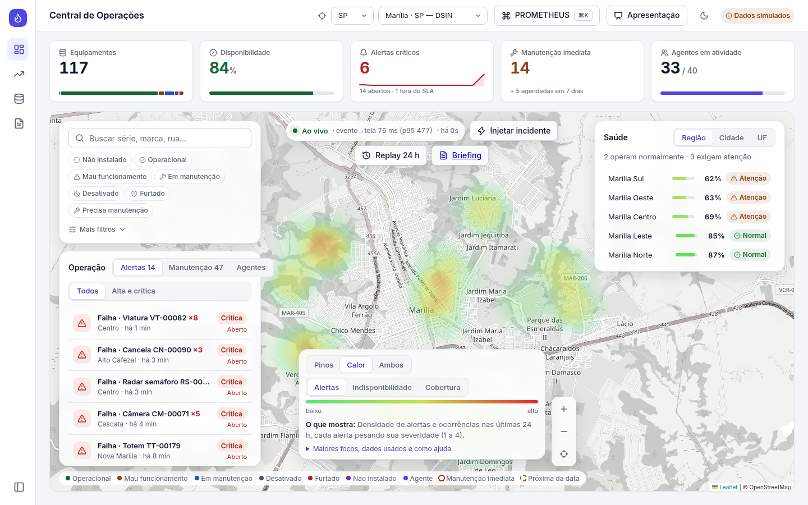
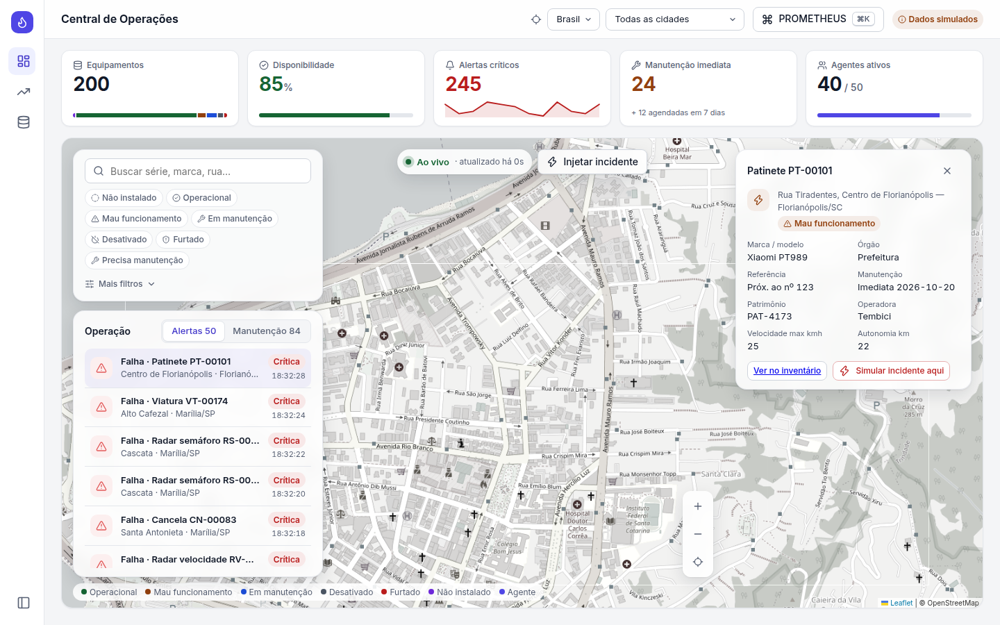

# F.O.G.O. — Documentação do Sistema

**Ferramenta Onisciente de Gestão e Operações** · DSIN Coder Challenge 2026 (Etapa Bônus, Protocolo PROMETHEUS)  
Autor e responsável: **@joojvitkk** · Desenvolvimento assistido por Claude Code (Anthropic), com todo o código revisado e aprovado pelo autor.

## Índice
1. [Visão geral](#1-visão-geral)
2. [Instalação e execução](#2-instalação-e-execução)
3. [Arquitetura](#3-arquitetura)
4. [Modelo de dados](#4-modelo-de-dados)
5. [Tipos de equipamento](#5-tipos-de-equipamento)
6. [Referência da API](#6-referência-da-api)
7. [Tempo real e simulador](#7-tempo-real-e-simulador)
8. [Módulo preditivo (Cidade Preditiva)](#8-módulo-preditivo-cidade-preditiva)
9. [Frontend](#9-frontend)
10. [Testes e qualidade](#10-testes-e-qualidade)
11. [Configuração](#11-configuração)
12. [Limitações e dados simulados](#12-limitações-e-dados-simulados)
13. [Mapeamento ao desafio](#13-mapeamento-ao-desafio)
14. [Créditos e uso de IA](#14-créditos-e-uso-de-ia)

---

## 1. Visão geral
O F.O.G.O. integra, numa única aplicação, as três partes do desafio:

1. **Inventário Inteligente da Cidade**: cadastro de equipamentos IoT de segurança e trânsito e dos agentes de campo.
2. **Central de Operações da Cidade**: visão em tempo real, num mapa, do que acontece na cidade (equipamentos, agentes, alertas, manutenção).
3. **Cidade Preditiva**: previsões explicáveis para agir antes que o problema aconteça.

Pergunta que a Central responde: *"Se algo estiver acontecendo na cidade agora, PROMETHEUS conseguirá perceber?"* A Preditiva responde: *"O que pode acontecer amanhã?"*

**Stack**

| Camada | Tecnologias |
|---|---|
| Backend | Python 3.12+, FastAPI, SQLModel/SQLAlchemy, SQLite, SSE, numpy e pandas |
| Frontend | React 19, Vite, TypeScript, react-leaflet (OpenStreetMap), leaflet.heat, Recharts, TanStack Query, React Router |
| Testes | pytest, ruff, vulture (backend); vitest, Testing Library, eslint, tsc (frontend) |
| Empacotamento | Docker Compose ou script `run.sh` |

**Escopo geográfico.** O mapa é centrado em **Marília/SP** (10 bairros reais em 5 regiões) e inclui 37 cidades reais do Brasil, cada uma com poucos equipamentos. Os dados são **fictícios** (ver [seção 12](#12-limitações-e-dados-simulados)).

## 2. Instalação e execução
**Pré-requisitos:** Docker (Compose v2) *ou* Python 3.12+ e Node 20+. Rede para os tiles do mapa (OpenStreetMap).

### 2.1 Docker
```bash
docker compose up
```
- Interface: http://localhost:5173 · API: http://localhost:8000 · API interativa (Swagger): http://localhost:8000/docs
- A primeira subida instala as dependências do frontend (~1 min).
- Portas ocupadas: `API_PORT=18000 WEB_PORT=15173 docker compose up`.
- O banco fica no volume `fogo-data` (`/data/fogo.db`).

### 2.2 Sem Docker
```bash
./run.sh
```
O script verifica Python/Node, cria `backend/.venv`, instala `requirements.txt`, executa `npm ci` no frontend e sobe a API (porta 8000) e o Vite (porta 5173). Aceita `API_PORT` e `WEB_PORT`.

### 2.3 Só o backend
```bash
cd backend
python3 -m venv .venv
.venv/bin/pip install -r requirements.txt
.venv/bin/uvicorn app.main:app
```

### 2.4 Primeira execução e reset
Na primeira subida o SQLite é criado e semeado: 10 bairros de Marília + 37 cidades, **200 equipamentos**, **50 agentes** e **~90 dias** de eventos e telemetria sintéticos (semente fixa, resultado determinístico). Se aparecer "banco desatualizado", apague `backend/fogo.db` (ou o volume `fogo-data`); os dados são recriados.

## 3. Arquitetura
```
┌────────────────────────┐   HTTP/JSON + SSE    ┌───────────────────────────────────────┐
│ Frontend (React + Vite)│ ───────────────────▶ │ Backend (FastAPI)                      │
│  Central · Inventário  │ ◀─────────────────── │  routers → services → CRUD/SQLModel    │
│  Preditiva · Briefing  │   /api/* (proxy)     │  predict/ (numpy/pandas)               │
└────────────────────────┘                      │  simulator/ (tarefa de fundo, 2 s)     │
                                                └───────────────┬───────────────────────┘
                                                                │ SQLite (fogo.db)
```

### 3.1 Backend (`backend/`)
| Caminho | Responsabilidade |
|---|---|
| `app/main.py` | Cria a aplicação, CORS, limite de escrita, inicia o simulador (`FOGO_SIM`) |
| `app/models.py` | Tabelas e enums (`Equipamento`, `Agente`, `Telemetria`, `Evento`, `Auditoria`) |
| `app/schemas.py` | Esquema de atributos **por tipo** (`TIPOS`), validações e modelos de resposta |
| `app/crud.py` | CRUD genérico reutilizado por equipamentos e agentes; filtros compartilhados |
| `app/db.py`, `app/seed.py` | Conexão SQLite, criação do esquema, semeadura determinística |
| `app/geo.py` | Bairros, regiões e cidades; marca as cidades com presença da DSIN confirmada |
| `app/limite.py` | Limite de escritas por IP (middleware) |
| `app/routers/` | `equipamentos`, `agentes`, `central`, `previsao`, `stream`, `demo`, `auditoria`, `inventario_io` |
| `app/services/` | `kpis`, `alertas`, `calor`, `briefing`, `telemetria`, `auditoria`, `stream` (barramento SSE) |
| `app/predict/` | `risco`, `anomalia`, `manutencao`, `reforco`, `cenarios`, `tendencia`, `backtest`, `dados`, `comum` |
| `simulator/sim.py` | Gera movimento de agentes, telemetria e eventos em tempo real |
| `tests/` | 99 testes (pytest) |

Decisões de projeto:
- **Uma tabela de equipamento com atributos em JSON**, validados por um esquema por tipo. Evita 15 tabelas e permite novos tipos sem migração. Custo: sem índice nos atributos.
- **CRUD genérico** compartilhado por equipamentos e agentes, e uma função de filtro única usada pela API e pelo Copilot.
- **Previsão sem serviços externos** (numpy/pandas), determinística e explicável.
- **SSE** em vez de WebSocket: fluxo só servidor → cliente, mais simples e com reconexão nativa.

### 3.2 Frontend (`frontend/src/`)
Ver [seção 9](#9-frontend).

## 4. Modelo de dados
### 4.1 Equipamento
| Campo | Tipo | Observações |
|---|---|---|
| `id` | int | chave primária |
| `tipo` | enum | um dos 15 tipos ([seção 5](#5-tipos-de-equipamento)) |
| `serie` | texto (≥3) | **único** (duplicado → HTTP 409) |
| `marca`, `modelo` | texto | obrigatórios |
| `orgao` | texto | órgão responsável |
| `cep` | texto | `NNNNN-NNN` (validado) |
| `bairro`, `regiao`, `cidade`, `uf`, `rua` | texto/enum | localização |
| `referencia` | texto livre | ex.: "nº 181", "oposto ao 181", "KM 203", "S/N", "em frente ao Mercado do Tio" |
| `lat`, `lon` | float | coordenadas GPS (−90..90 / −180..180) |
| `situacao` | enum | `nao_instalado`, `operacional`, `mau_funcionamento`, `em_manutencao`, `desativado`, `furtado` |
| `manutencao_tipo` | enum | `imediata`, `agendada`, `nenhuma` |
| `proxima_manutencao` | data | obrigatória quando `agendada` |
| `atributos` | JSON | campos específicos validados pelo esquema do tipo |

### 4.2 Agente
`id`, `nome`, `matricula` (única), `categoria` (`transito`, `guarda`, `policia`), `orgao`, `status` (`ativo`, `inativo`, `em_ocorrencia`), `cidade`, `uf`, `lat`, `lon`, `atualizado_em`.

### 4.3 Telemetria
`id`, `equipamento_id` (FK, cascata), `ts`, `metricas` (JSON: latência, temperatura, taxa de erro, bateria…), `situacao`.

### 4.4 Evento (alerta)
`id`, `ts`, `inicio`, `bairro`, `tipo` (`falha`, `ocorrencia`, `alerta`), `severidade` (1 a 4), `equipamento_id`, `status` (`aberto`, `reconhecido`, `em_atendimento`, `resolvido`), `ocorrencias` (repetições do mesmo equipamento agrupadas em 6 h), `agente_id`, `reconhecido_em`, `resolvido_em`.
**SLA por severidade** (4→1): 15, 30, 120 e 480 minutos; a API devolve `sla_prazo` e `sla_estourado`.

### 4.5 Auditoria
Registro de criação, alteração (com diff), exclusão e importação de equipamentos e agentes (`ts`, entidade, ação, `detalhe` em JSON).

## 5. Tipos de equipamento
`GET /api/tipos` devolve o JSON Schema dos atributos de cada tipo; o formulário do Inventário é **gerado a partir dele** (nenhum formulário por tipo escrito à mão).

| Tipo (`tipo`) | Rótulo | Atributos específicos |
|---|---|---|
| `radar_velocidade` | Radar de velocidade | faixas, sentido, velocidade_via_kmh, modo |
| `radar_semaforo` | Radar de semáforo (avanço de sinal) | faixas, sentido, tempo_amarelo_s |
| `radar_conversao_proibida` | Radar de conversão proibida | faixas, sentido, conversao_proibida |
| `camera` | Câmera de videomonitoramento | resolucao, leitura_placa, visao_noturna, ptz |
| `balanca` | Balança de caminhão | capacidade_ton, modo, eixos_max |
| `veiculo_autonomo` | Veículo autônomo de fiscalização | placa, nivel_autonomia, autonomia_km, sensores |
| `cancela` | Cancela automatizada | tipo_acesso, largura_m, leitor_tag |
| `taxi` | Táxi | placa, alvara, capacidade_passageiros, ponto, taximetro_lacre |
| `mototaxi` | Mototáxi | placa, alvara, capacidade_passageiros, capacete_extra |
| `transporte_escolar` | Transporte escolar | placa, alvara, capacidade_passageiros, vistoria_ate |
| `totem` | Totem de estacionamento rotativo | funcao, altura_cm, tela_polegadas, touch |
| `patinete` | Patinete elétrico | patrimonio, operadora, velocidade_max_kmh, autonomia_km |
| `moto_agente` | Moto de agente | placa, prefixo, cilindrada_cc |
| `viatura` | Viatura GM/PM | corporacao, placa, prefixo, modalidade |
| `outro` | Outro | descricao, extras |

## 6. Referência da API
Base: `http://localhost:8000` (ou `/api` pelo proxy do Vite). Documentação interativa em `/docs` e esquema em `/openapi.json`.

**Convenções**
- Corpos e respostas em JSON; erros no formato `{"detail": ...}`.
- Listas devolvem um **array puro**; o total vem no cabeçalho `X-Total-Count`. Paginação com `limit` (máx. 500) e `offset`.
- Parâmetros de consulta desconhecidos retornam **422**.
- `PUT` substitui o recurso inteiro (mesmo corpo do `POST`). Série ou matrícula duplicada → **409**.
- Escritas (`POST`/`PUT`/`DELETE`) são limitadas por IP (`FOGO_RATE`, padrão 120/min) → **429**.
- Escopo geográfico opcional `?cidade=&uf=` em `central`, `previsao`, `equipamentos` e `agentes`.

### 6.1 Equipamentos
| Método e rota | Descrição | Parâmetros |
|---|---|---|
| `GET /api/equipamentos` | Lista com filtros | `tipo`, `situacao`, `bairro`, `regiao`, `cidade`, `uf`, `orgao`, `q`, `precisa_manutencao`, `limit`, `offset` |
| `POST /api/equipamentos` | Cria | corpo: campos da seção 4.1 |
| `GET /api/equipamentos/{id}` | Detalha | |
| `PUT /api/equipamentos/{id}` | Atualiza | |
| `DELETE /api/equipamentos/{id}` | Remove | |
| `GET /api/equipamentos/{id}/linha-do-tempo` | Histórico do equipamento (auditoria, alertas) | `limit` |
| `GET /api/equipamentos/exportar` | Exporta CSV ou GeoJSON (respeita os filtros) | `formato=csv ou geojson` + filtros |
| `POST /api/equipamentos/importar` | Importa CSV ou GeoJSON, tudo ou nada, com relatório de erros | `formato`, `simular` (só valida) |

Importação: corpo ≤ 5 MB e ≤ 5.000 linhas (HTTP 413), relatório limitado a 200 erros, fórmulas de planilha (`=`, `+`, `-`, `@`) neutralizadas na exportação.

### 6.2 Agentes e tipos
| Método e rota | Descrição | Parâmetros |
|---|---|---|
| `GET /api/agentes` | Lista | `categoria`, `status`, `cidade`, `uf`, `orgao`, `q`, `limit`, `offset` |
| `POST /api/agentes` | Cria | |
| `GET`/`PUT`/`DELETE /api/agentes/{id}` | Lê, atualiza, remove | |
| `GET /api/tipos` | JSON Schema dos atributos por tipo | |
| `GET /api/auditoria` | Trilha de auditoria | `entidade`, `entidade_id`, `limit` |

### 6.3 Central de Operações
| Método e rota | Descrição | Parâmetros |
|---|---|---|
| `GET /api/central/kpis` | Total, por situação, disponibilidade %, agentes (total, ativos, em ocorrência), alertas críticos/abertos/fora do SLA, manutenção imediata e agendada em 7 dias | `cidade`, `uf` |
| `GET /api/central/regioes` | Saúde por região, cidade ou UF, com estado `normal`/`atencao`/`critico` | `por=regiao ou cidade ou uf`, `cidade`, `uf` |
| `GET /api/central/cidades` | Cidades disponíveis e se há presença DSIN confirmada | |
| `GET /api/central/alertas` | Alertas, mais graves primeiro | `horas`, `sev_min`, `limit`, `status=abertos ou todos ou <status>`, `cidade`, `uf` |
| `POST /api/central/alertas/{id}/reconhecer` | Marca como reconhecido | |
| `POST /api/central/alertas/{id}/despachar` | Despacha agente; devolve distância e ETA | `agente_id` |
| `POST /api/central/alertas/{id}/resolver` | Resolve | |
| `GET /api/central/manutencao` | Equipamentos que precisam de manutenção (imediatas primeiro, depois por data) | filtros de equipamentos |
| `GET /api/central/calor` | Mapa de calor: pontos com peso e maiores focos | `modo=alertas ou indisponibilidade ou cobertura`, `horas`, `raio_km`, filtros |
| `GET /api/central/replay` | Reprodução cronológica das últimas horas | `horas`, `cidade`, `uf` |
| `GET /api/central/briefing` | Resumo da situação, 3 riscos em 6 h e ações (por regras) | `cidade`, `uf` |

Despacho: ETA = distância × 1,3 / 40 km/h. O simulador move o agente até o local e o alerta passa a `em_atendimento`.

### 6.4 Tempo real e demonstração
| Método e rota | Descrição |
|---|---|
| `GET /api/stream` | Fluxo SSE ([seção 7](#7-tempo-real-e-simulador)) |
| `POST /api/demo/incidente` | Injeta um incidente: `{"bairro":"Fragata"}` ou `{"equipamento_id":1,"tipo":"falha","severidade":4}`; despacha o agente ativo mais próximo da mesma UF. Resposta 201: `{alerta, agente_acionado, eta_min}` |
| `GET /api/health` | `{"status":"ok"}` |

### 6.5 Previsão
Todas as respostas trazem o envelope `{preve, dados_usados, recomendacao, ...}`, para deixar claro **o que se prevê, com quais dados e como isso ajuda a decidir**. Escopo sem equipamentos → 404.

| Método e rota | Descrição | Parâmetros |
|---|---|---|
| `GET /api/previsao/risco` | Matriz local × hora com `score` (0 a 100), intervalo de confiança e `fatores` | `horas`, `agrupar=bairro ou cidade ou uf`, `cidade`, `uf` |
| `GET /api/previsao/anomalias` | Comportamentos fora do padrão na telemetria | `limiar`, `cidade`, `uf` |
| `GET /api/previsao/manutencao-preditiva` | Probabilidade de falha em 7 dias e ordens de serviço sugeridas | `limite`, `cidade`, `uf` |
| `GET /api/previsao/reforco` | Plano de realocação de agentes, cobertura antes/depois e lacunas | `horas`, `raio_km`, `cidade`, `uf` |
| `GET /api/previsao/cenario` | Simulação *what-if* | `evento=chuva ou evento_bairro ou falha_equipamento` (obrigatório), `bairro`, `equipamento_id` |
| `GET /api/previsao/tendencias` | Tendência de disponibilidade e uso | `cidade`, `uf` |
| `GET /api/previsao/backtest` | Avalia o método: treina até D−N e compara com os N dias seguintes | `dias`, `cidade`, `uf` |

## 7. Tempo real e simulador
O simulador (`simulator/sim.py`) é uma tarefa assíncrona iniciada com a API (desligue com `FOGO_SIM=0`). A cada tick de 2 s: move os agentes, grava telemetria, gera eventos e publica tudo num barramento em memória. Cada cliente SSE tem uma fila própria.

**`GET /api/stream`** (cabeçalho inicial `: conectado`, batimento `: hb` a cada 15 s). Eventos, com `data` em JSON:

| Evento | Conteúdo |
|---|---|
| `agente` | lista de agentes completos (~a cada 2 s) |
| `telemetria` | lista `{equipamento_id, ts, metricas, situacao}` |
| `alerta` | um alerta (mesmo formato de `/central/alertas`) |
| `kpis` | mesmo corpo de `/central/kpis` |

Cada quadro traz `id: <epoch ms de emissão>`, usado pelo frontend para exibir a **latência evento → tela** (medida em 42–97 ms em ambiente local).

## 8. Módulo preditivo (Cidade Preditiva)
Todos os algoritmos usam apenas numpy/pandas, leem DataFrames de um adaptador SQL (`predict/dados.py`, com cache de 5 s por escopo) e são determinísticos.

| Módulo | O que prevê | Como |
|---|---|---|
| `risco.py` | Risco por local × hora (0 a 100) | Contagem histórica de eventos por bairro, dia da semana e hora, mais fatores de equipamentos degradados e tendência; intervalo de confiança por piso de Poisson. Cada ponto devolve seus **fatores** ("por quê?") |
| `anomalia.py` | Comportamento fora do padrão | EWMA com z-score robusto (MAD) sobre a telemetria |
| `manutencao.py` | Falha em 7 dias por equipamento | Deriva de latência, erro e temperatura (EWMA + tendência); gera ordens de serviço priorizadas |
| `reforco.py` | Onde reforçar agentes e lacunas de cobertura | Heurística gulosa (distância × déficit de cobertura); cada agente se move uma vez, até 60 km; lacunas = pontos sem equipamento operacional nem agente num raio |
| `cenarios.py` | E se chover / houver evento / uma câmera falhar? | Recalcula risco e cobertura com a mudança aplicada e compara com a base |
| `tendencia.py` | Tendência de disponibilidade e utilização | Série diária de 30 dias de disponibilidade e utilização, com projeção linear (mínimos quadrados) de 7 dias e faixa de incerteza |
| `backtest.py` | Quão confiável é a previsão | Treino até D−7, comparação com os 7 dias seguintes |

**Backtest (sobre os dados sintéticos):** 4 dos 5 bairros mais perigosos previstos (acaso: 0,53), correlação de postos 0,89; manutenção com precisão top-10 de 100 % (taxa-base 8 %) e erro médio de 4 % contra 15 % de quem chuta a média. Como os dados são sintéticos, isso mostra que o método recupera a estrutura embutida na simulação, **não** desempenho em campo.

## 9. Frontend
Rotas (React Router): `/central`, `/preditiva`, `/inventario`, `/briefing` (qualquer outra redireciona para `/central`).

| Página | Conteúdo |
|---|---|
| **Central** (`pages/Central/`) | Mapa protagonista com painéis flutuantes, KPIs em faixa, alertas com SLA e despacho, manutenção em 3 grupos (imediata / próxima / mais adiante), saúde por região/cidade/UF, mapa de calor (alertas, indisponibilidade, cobertura), replay 24 h, botão "Injetar incidente" |
| **Inventário** (`pages/Inventario/`) | Tabela densa, filtros, gaveta lateral para criar/editar com formulário dinâmico, CEP via ViaCEP (com fallback offline), importação e exportação CSV/GeoJSON, linha do tempo |
| **Preditiva** (`pages/Preditiva/`) | Mapa de risco com slider de tempo (agora a +24 h), "por quê?", calor do risco previsto, manutenção preditiva, reforço e lacunas, *what-if*, anomalias, backtesting |
| **Briefing** (`pages/Briefing/`) | Relatório de situação imprimível |

Recursos transversais: seletor de UF/cidade no topo (o mapa reenquadra), paleta de comando **Ctrl/⌘+K** ("Copilot" em português por regras, `lib/copilot.ts`), **modo apresentação** (tour de 3 min), tema claro/escuro, indicador "ao vivo", selo "Dados simulados", layout responsivo (barra inferior no celular) e skip-link de acessibilidade.

Organização: `api/` (cliente e tipos), `components/` (Mapa, Filtros, FormularioDinamico, Kpi, Calor, Tour…), `hooks/` (`useStream`, `useEscopo`, `useTema`…), `lib/` (utilidades, calor, copilot, CEP). As páginas são carregadas sob demanda e as bibliotecas pesadas (mapa e gráficos) ficam em *chunks* próprios.







## 10. Testes e qualidade
```bash
# Backend
cd backend && .venv/bin/pip install -r requirements-dev.txt
.venv/bin/pytest -q            # 99 testes
.venv/bin/ruff check .         # lint
.venv/bin/vulture              # código morto
.venv/bin/pytest --cov=app --cov=simulator   # cobertura (~99 %)

# Frontend
cd frontend && npm ci
npx tsc --noEmit && npx eslint src && npx vitest run && npm run build
npx vitest run --coverage      # cobertura (~89 % das linhas)
```
Resultados da última validação: 99 testes de backend e 51 de frontend passando; lint e *type-check* limpos. Desempenho, acessibilidade (axe-core), bugs encontrados e correções estão em [`RELATORIO.md`](RELATORIO.md); a matriz requisito × implementação × evidência em [`AUDITORIA.md`](AUDITORIA.md).

## 11. Configuração
Todas as variáveis são opcionais.

| Variável | Padrão | Efeito |
|---|---|---|
| `FOGO_DB` | `sqlite:///backend/fogo.db` (no Docker: `sqlite:////data/fogo.db`) | URL do banco |
| `FOGO_CORS` | `http://localhost:5173,http://127.0.0.1:5173` | Origens aceitas (separadas por vírgula) |
| `FOGO_SIM` | `1` | `0` desliga o simulador em tempo real |
| `FOGO_RATE` | `120` | Escritas por minuto e por IP; `0` desliga o limite |
| `API_PORT` | `8000` | Porta da API (`run.sh` e Compose) |
| `WEB_PORT` | `5173` | Porta da interface (`run.sh` e Compose) |
| `VITE_API` | `http://localhost:8000` | Alvo do proxy `/api` do Vite |

Dependências: `backend/requirements.txt` (runtime, Python 3.12) e `backend/requirements-dev.txt` (testes, lint e cobertura); `frontend/package.json` e `package-lock.json`.

## 12. Limitações e dados simulados
- **Todos os equipamentos, agentes, eventos e telemetria são fictícios** (semente fixa), com selo e rodapé na interface. Só SP, PR e MT têm respaldo público de presença da DSIN (`PESQUISA_DSIN.md`); as demais cidades são simulação de demonstração.
- Coordenadas dos bairros de Marília são aproximadas.
- Previsões sobre dados sintéticos não foram validadas contra a realidade.
- Processo único com SQLite; **sem autenticação** (fora do escopo do desafio, que pede uma visão única para gestores).
- A tabela de telemetria cresce sem política de retenção; o cache de 5 s é por processo.
- O mapa depende de rede (tiles OSM). Marcadores de agentes sobrepostos ainda falham o critério `target-size` do axe.
- Não verificados: leitor de tela real, zoom de 200 %, celular físico, execução contínua por dias.
- Próximos passos: retenção da telemetria, WAL no SQLite, calibração com dados reais anonimizados, testes E2E, agrupamento de marcadores de agentes.

## 13. Mapeamento ao desafio
| Requisito do desafio | Onde está |
|---|---|
| Catálogo de equipamentos (tipo, série/marca/modelo, localização com CEP, bairro, cidade/UF, rua, referência e GPS, situação, manutenção, características por tipo) | `models.py`, `schemas.py`, `/api/equipamentos`, `/api/tipos`, página Inventário |
| Cadastro de agentes (trânsito, guarda, polícia) | `/api/agentes`, aba Agentes |
| Dashboard integrado a um mapa, ícones por tipo, situação visível | Central, `components/Mapa.tsx`, `Icone.tsx` |
| Indicadores (total, operacionais, indisponíveis, % disponibilidade, agentes em atividade) | `/api/central/kpis`, faixa de KPIs |
| Filtros (tipo, situação, bairro, região, órgão…) | `components/Filtros.tsx`, parâmetros da API |
| Manutenção imediata ou próxima da data | `/api/central/manutencao`, painel Manutenção |
| Alertas críticos e destaque | `/api/central/alertas` (severidade 1–4, SLA), mapa com pino pulsante |
| Detalhes pelo mapa | Clique em equipamento, agente ou alerta |
| Visão consolidada por região | `/api/central/regioes` (Normal / Atenção / Crítico) |
| Extras: mapa de calor, gráficos, criticidade, agrupamento por região | `/api/central/calor`, saúde por região/cidade/UF |
| Previsão: horários e regiões críticas, reforço de agentes, anomalias, tendências, índices de risco, alertas preventivos | `/api/previsao/*`, página Preditiva |
| Deixar claro o que se prevê, com quais dados e como ajuda | Envelope `{preve, dados_usados, recomendacao}` e cartões da Preditiva |
| Rodar de primeira e vídeo | `docker compose up` / `./run.sh`; `video/fogo-apresentacao.mp4` |
| Informar IA utilizada e demonstrar entendimento | [Seção 14](#14-créditos-e-uso-de-ia) e `RELATORIO.md` |

## 14. Créditos e uso de IA
- **Autor e responsável:** [@joojvitkk](https://github.com/joojvitkk). Definiu o escopo e **todas as regras de negócio e de previsão** do sistema, **revisou todo o código e aprovou cada parte** antes da entrega.
- **IA utilizada:** Claude Code (Anthropic), empregado para escrever e revisar código a partir das regras definidas pelo autor, com papéis separados por área (backend, preditivo, frontend, revisão de qualidade, validação).
- O produto **não chama nenhuma IA externa em execução**: o "Copilot PROMETHEUS" é implementado com regras e expressões regulares, e as previsões usam estatística clássica (numpy/pandas).
